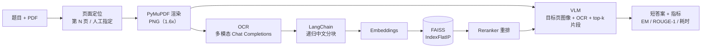

<p align="center">
  简体中文 · <a href="./README_EN.md">English</a>
</p>

<!-- README_SYNC: source=working-tree; updated=2026-10-26 -->

<h1 align="center">InduDoc AI · 工业文档多模态问答评测工作台</h1>

<p align="center">
把不可编辑的工业专利 PDF，变成<strong>证据可定位、过程可回放、指标按比赛口径计算</strong>的问答评测链路。
</p>

<p align="center">
如果它正好是你在搭的那套文档问答评测框架，点个 <a href="https://github.com/2539996722/Multimodal-Reasoning-Question-Answering/stargazers">Star</a> 收藏一下，也方便更多做同类任务的人找到它。
</p>

<p align="center">
  <a href="https://github.com/2539996722/Multimodal-Reasoning-Question-Answering/stargazers"></a>
  <a href="https://github.com/2539996722/Multimodal-Reasoning-Question-Answering/issues"></a>
  <a href="https://github.com/2539996722/Multimodal-Reasoning-Question-Answering/commits/main"></a>
  
  
  
</p>

<p align="center"></p>

> 上图是首次启动后的真实首页。900 / 7,502 / 2,038 三个数字来自 `/api/datasets` 对数据目录的实时扫描，四类模型状态来自运行时配置——页面上没有任何写死的统计值。

**一句话**：面向 CCKS2025「工业技术文档多模态推理问答」评测任务的工作台，统一处理初赛四选一（300 + 4,000 题）与复赛开放问答（600 + 3,502 题），模型侧只要求 OpenAI-compatible 协议。

**先划边界**（它会节省你判断的时间）：

- **不含数据**：比赛 PDF 与 JSONL 需自行按约定目录放置，见 [快速开始](#快速开始)。
- **不训练模型**：平台只负责推理与评测；LoRA 微调 → vLLM 部署 → 接回工作台的流程在 [runtime/lora-data/README.md](./runtime/lora-data/README.md)。
- **不做上传、多租户、分布式调度**：单人单机工作台，数据目录只读。

<details>
<summary>目录</summary>

- [它解决什么问题](#它解决什么问题)
- [快速开始](#快速开始)
- [处理链路](#处理链路)
- [一次真实运行留下了什么](#一次真实运行留下了什么)
- [界面](#界面)
- [评测口径](#评测口径)
- [A/B 实测：OCR+VLM 基线 vs RAG](#ab-实测ocrvlm-基线-vs-rag)
- [四模型配置](#四模型配置)
- [数据规模](#数据规模)
- [API 速查](#api-速查)
- [可靠性设计](#可靠性设计)
- [已知限制](#已知限制)
- [测试与验收](#测试与验收)
- [目录结构](#目录结构)
- [许可证](#许可证)

</details>

## 它解决什么问题

工业专利文档是**扫描件**：没有文字层、图纸和正文混排、答案常常落在「第 7 页的附图里某个编号的左右关系」上。通用大模型拿到整份 PDF 只会给你一段流畅但无法核对的解释，你也无法判断它到底看了哪一页。

所以这里不做「又一个 PDF 问答」，而是把**证据链**做成一等公民：

| 手工流程 | 这个工作台 |
| --- | --- |
| 翻 PDF 找「第 N 页」，肉眼比对图纸 | 题干解析页码 → PyMuPDF 渲染该页 → 证据页固定在报告里 |
| OCR 结果粘进对话框，上下文越聊越乱 | 分块 → 向量召回 → 重排，top-k 片段和来源页码一起留痕 |
| 答案对不对全凭感觉 | Accuracy / EM / jieba ROUGE-1 按比赛口径计算，缺真实 BERTScore 就写 `null` |
| 4,000 道测试题手工复制粘贴 | 批量任务 + 进度 + 失败重试 + 比赛格式 JSONL 导出 |

三个和「调个 API 套壳」不一样的地方：

1. **四类能力四个端点**：OCR、VLM、Embedding、Reranker 各自独立配置，可分别指向不同服务（含本地 vLLM），互不牵连。
2. **指标不注水**：官方综合分需要真实 BERTScore，在线一律返回 `null` 并给出原因，只在离线回归里由独立子进程产出——避免把语义评审分冒充成官方分。
3. **降级可见**：RAG 不可用时明确标注「已降级为目标页 OCR + VLM」，不把降级伪装成 RAG 命中。

## 快速开始

需要 Python 3.10+；`node` 只在跑浏览器验收时才需要。

```powershell
git clone https://github.com/2539996722/Multimodal-Reasoning-Question-Answering.git
cd Multimodal-Reasoning-Question-Answering

py -3 -m venv .venv
.\.venv\Scripts\Activate.ps1
python -m pip install -r requirements.txt
```

**1）把比赛数据放到固定目录**（仓库不含数据，下面这些结构在 [`app/services/dataset.py`](./app/services/dataset.py) 里硬编码）：

```text
preliminary_dataset/
  train/questions.jsonl            # 300 题（含 answer 字段）
  test/questions.jsonl             # 4,000 题
  test/answers.jsonl               # 4,000 条参考答案
  {train,test}/documents/*.pdf     # 851 份
semi_final_dataset/
  train/train.jsonl                # 600 题（含 answer）
  test/test.jsonl                  # 3,502 题
  test/answers.jsonl               # 3,502 条参考答案
  {train,test}/documents/*.pdf     # 1,187 份
```

**2）配置四类模型端点**（任选环境变量或启动后在「模型设置」页填；VLM 也可以指向自己部署的 vLLM 服务）：

```powershell
$env:OCR_BASE_URL       = "https://api.siliconflow.cn/v1"
$env:OCR_API_KEY        = "<your-key>"
$env:OCR_MODEL          = "Qwen/Qwen3-VL-8B-Instruct"

$env:VLM_BASE_URL       = "https://api.siliconflow.cn/v1"
$env:VLM_API_KEY        = "<your-key>"
$env:VLM_MODEL          = "Qwen/Qwen3-VL-32B-Instruct"

$env:RETRIEVAL_BASE_URL = "https://api.siliconflow.cn/v1"
$env:RETRIEVAL_API_KEY  = "<your-key>"
$env:RETRIEVAL_MODEL    = "Qwen/Qwen3-Embedding-4B"

$env:RERANKER_BASE_URL  = "https://api.siliconflow.cn/v1"
$env:RERANKER_API_KEY   = "<your-key>"
$env:RERANKER_MODEL     = "Qwen/Qwen3-Reranker-4B"
```

**3）启动**（`start` 为后台启动，写 `runtime/server.pid` 与 `runtime/server.log`；`status` 查看端口与 PID）：

```powershell
.\start.bat
.\start.bat start
.\start.bat status
```

**4）打开 <http://127.0.0.1:8000>**，在「模型设置」里点一次连通性测试，然后随便选一道题点「开始分析」。

> 没配模型也能启动：界面会进入**明确标识**的演示模式，用参考答案回放，不会把回放伪装成模型输出。批量评测默认走真实链路，模型配置不全时直接报配置错误，不静默降级。

## 处理链路



复赛默认 `use_rag=true`；没配 Retrieval / Reranker 或显式关闭时，降级为目标页 OCR + VLM，并在 trace 和运行摘要里写明降级原因。

## 一次真实运行留下了什么

<p align="center"></p>

左边是答案与参考答案的逐句对照，中间是 RAG 检索报告（24 个分块 → 召回 12 → 重排 6，语料来源分别标了 PDF 原生文本与 OCR 文本），右边是六步执行 trace：定位渲染 → 目标页 OCR → 分块 → 向量召回 → 候选精排 → 图文联合推理，每一步都有耗时和 provider 标签。

这张图想说明的是：**出了错你能定位到哪一步**，而不是只看到一句「模型回答」。

## 界面

<table>
<tr>
<td></td>
<td></td>
</tr>
<tr>
<td>题目队列 + PDF 原件预览 + 证据面板三栏联动，左边列表里带「P.5」标记的题会直接跳到证据页。</td>
<td>同一套界面在 390px 宽度下不出现横向滚动。</td>
</tr>
</table>

前端是原生 HTML/CSS/JS，没有框架和构建步骤；字体本地自托管，运行时不依赖任何 CDN。

## 评测口径

| 字段 | 含义 | 在线可用 |
| --- | --- | :---: |
| `accuracy` | 初赛四选一准确率 | ✅ |
| `exact_match` | 复赛规范化 EM | ✅ |
| `rouge1_f1` | jieba 分词 ROUGE-1 F1（比赛口径） | ✅ |
| `semantic_f1` | **LLM 语义评审分**，任意 OpenAI-compatible 模型可算，非官方 BERTScore | 需显式开启 |
| `semantic_proxy_score` | 用官方权重算的**代理分**，字段名带 proxy | 需显式开启 |
| `bert_f1` | **仅**代表真实 BERTScore；在线恒为 `null`，附 `bert_f1_reason` | ❌ |
| `final_score` | `0.5×BERTScore + 0.25×ROUGE-1 + 0.25×EM`，只在**离线回归**产出 | ❌ |

语义评审是额外的模型调用，默认关闭；单题与批量请求可传 `evaluate_semantic: true`。

**为什么坚持 `null`**：`bert_score` 会加载 `torch`，而 `torch` 与 `faiss` 同进程共存会硬崩溃（进程直接退出、无 traceback）。所以 BERTScore 只能由 [`scripts/bertscore_worker.py`](./scripts/bertscore_worker.py) 在独立子进程计算；子进程不可用时记「未计算」并写明原因，绝不填假分数。

## A/B 实测：OCR+VLM 基线 vs RAG

复赛 train 集，seed `20261025`，8 题 / 4 个 PDF（按 PDF 分组，两臂题集相同）：

| 指标 | baseline（目标页 OCR + VLM） | rag（分块 → FAISS → Rerank → VLM） | 差值 |
| --- | ---: | ---: | ---: |
| EM | 0.1250 | 0.2500 | **+0.1250** |
| ROUGE-1 F1 | 0.6005 | 0.6327 | +0.0322 |
| BERTScore F1（bert-base-chinese） | 0.7987 | 0.8244 | +0.0256 |
| 官方综合分 | 0.5808 | **0.6329** | **+0.0521** |
| Recall@1 / @3 / @6 | 不适用 | 0.40 / 0.40 / 0.60 | — |
| MRR | 不适用 | 0.45 | — |
| 平均耗时 | 69.3 s | 60.7 s | −8.6 s |
| P95 耗时 | 127.8 s | 103.4 s | −24.4 s |

报告原文在 [`runtime/regression/`](./runtime/regression)，可用同一条命令复现：

```powershell
python scripts\evaluate_regression.py --size 8 --seed 20261025 --arms baseline,rag --timeout 300
```

> **样本只有 8 题、4 个 PDF，不具统计代表性**。对外结论需要 `--size 60` 以上的正式回归跑；检索指标只统计题干里带「第 N 页」的 5 题，另外 3 题记为「不适用」而不是 0。

## 四模型配置

四类能力彼此独立，各自拥有 Base URL / API Key / Model / Timeout，改完写进 `runtime/model-settings.json`（含明文密钥，已在 `.gitignore` 里）。公共接口只返回 `api_key_set` / `configured`，绝不回显密钥。

实测可用的一组（SiliconFlow）：

| 角色 | 模型 | 实测 |
| --- | --- | --- |
| OCR | `Qwen/Qwen3-VL-8B-Instruct` | 单页约 20 s，能稳定读出中文专利页的部件编号 |
| VLM（质量） | `Qwen/Qwen3-VL-32B-Instruct` | 单题 37–70 s，空间关系题明显优于 8B |
| VLM（速度） | `Qwen/Qwen3-VL-8B-Instruct` | 单题 20–30 s |
| Retrieval | `Qwen/Qwen3-Embedding-4B` | 走原生 `POST /v1/embeddings` |
| Reranker | `Qwen/Qwen3-Reranker-4B` | 走原生 `POST /v1/rerank`，失败自动降级为 Chat 打分 |

三个踩过的坑：

- **OCR 提示词决定输出形态**：换成「识别这一页的技术内容」这类泛化提示词，PaddleOCR-VL 会一路写满 `max_tokens`（实测 155 s、撞满 2400 token）。换模型前先用真实提示词测一页。
- **不要发 `image_url.detail`**：部分网关直接 400（`Input should be a valid string`），后端默认不发，需要时用 `MODEL_IMAGE_DETAIL=high` 打开。
- **上游长尾排队**：连续密集调用后单页可能从 20 s 退化到 160 s，所以 OCR 超时单独配置，并用预计算语料把重复 OCR 挡在模型调用之外。

接自己部署的 vLLM 时注意三点：`configured` 要求 base_url / api_key / model 三者都非空，而 vLLM 默认不鉴权——起服务时加 `--api-key`，或在设置页随便填一个非空串；Model 要填 `--lora-modules` 冒号左边的服务名，不是权重路径；**别和本机端口打架**——工作台自己占 8000，同机部署 vLLM 请换端口（如 `8001`），跨机器则填 `http://<实例IP>:8000/v1`。

## 数据规模

| 阶段 | 任务类型 | 训练题 | 测试题 | PDF | 指标 |
| --- | --- | ---: | ---: | ---: | --- |
| 初赛 | 四选一 | 300 | 4,000 | 851 | Accuracy |
| 复赛 | 开放问答 | 600 | 3,502 | 1,187 | 0.5×BERTScore + 0.25×ROUGE-1 + 0.25×EM |

原始 JSONL 与 PDF 永远只读，系统不提供上传入口。

## API 速查

| 方法 | 路径 | 用途 |
| --- | --- | --- |
| GET | `/api/health`、`/api/health/live`、`/api/health/ready` | 服务、数据集、RAG 运行时健康 |
| GET | `/api/datasets` | 初/复赛资产与异常统计（首页数字来源） |
| GET | `/api/questions` | 分页筛选题目 |
| GET | `/api/questions/{stage}/{split}/{id}` | 题目详情与参考答案 |
| GET | `/api/documents/{stage}/{split}/{filename}` | PDF 原件（inline / download） |
| GET | `/api/documents/{stage}/{split}/{filename}/pages/{page}` | 指定页 PNG |
| GET | `/api/documents/{stage}/{split}/{filename}/ocr` | 预计算 OCR 语料只读视图 |
| POST | `/api/analyze`、`/api/analyze/stream` | 单题分析（SSE 推阶段事件） |
| POST/GET | `/api/jobs`、`/api/jobs/{id}` | 批量任务创建、列表、进度 |
| POST | `/api/jobs/{id}/cancel`、`/api/jobs/{id}/retry` | 取消、失败项重试 |
| GET | `/api/jobs/{id}/export` | 比赛格式 JSONL（每行 `{"id":...,"answer":...}`） |
| GET | `/api/runs` | 最近 100 条运行摘要 |
| GET/PUT | `/api/settings/models` | 脱敏读取 / 更新四模型配置 |
| POST | `/api/settings/models/test` | 主动连通性测试 |

错误响应统一为：

```json
{"error": {"code": "DOCUMENT_NOT_FOUND", "message": "未找到指定文档", "request_id": "...", "retryable": false}}
```

## 可靠性设计

- **索引生命周期**：`absent → building → ready → stale / failed`。版本键由 PDF 指纹、分块参数、Embedding 模型、维度与 schema 共同决定，任一变化即把旧版本标 stale，禁止跨模型跨维度复用。
- **single-flight 构建**：按文档加锁 + 全局有界信号量，写临时目录自检后原子发布，失败保留上一份 ready。
- **查询快照**：一次检索从头到尾绑定同一个 immutable ready 版本，新版本发布不影响在途请求。
- **索引落盘只存三个安全文件**：`vectors.npy`（`allow_pickle=False`）、`documents.json`、`manifest.json`，加载时重建 `IndexFlatIP`；不用 pickle / joblib，不用 `allow_dangerous_deserialization`。
- **OCR 语料身份校验**：源 PDF 指纹或 OCR 模型任一不匹配即判 stale，不再作为证据使用，改走实时 OCR，并在界面标注「由旧模型生成」。
- **降级顺序**：最后可用 ready 索引 → 重建 → 词法召回 → 跳过 Reranker → 目标页 OCR + VLM → 明确演示模式/失败。每次降级都在界面与运行摘要里可见。
- **日志不含敏感内容**：只记端点主机、模型名、状态码、耗时与脱敏错误摘要；不记 API Key、PDF 全文、OCR 全文、完整 prompt/response 与隐藏思维链。

## 已知限制

| 现象 | 原因与处置 |
| --- | --- |
| `MODEL_BALANCE_EXHAUSTED` | 上游 402 余额不足，不可重试；换端点或充值 |
| `MODEL_REQUEST_REJECTED` + 上游 400 | 网关拒绝请求体字段；已默认去掉 `image_url.detail` |
| `MODEL_TIMEOUT` | 上游慢；调大 `OCR_TIMEOUT_SECONDS` / `VLM_TIMEOUT_SECONDS` |
| 复赛 OCR 提示「预计算语料已过期」 | OCR 模型或源 PDF 变了，用 `scripts/precompute_semifinal_ocr.py` 重建 |
| `pytest` exit=3 且无 traceback | 同进程混用了 `torch` 与 `faiss`；BERTScore 必须走子进程 |
| PDF 页码越界 | 原件仍可预览，页 PNG 接口返回明确能力错误 |

## 测试与验收

```powershell
python -m pytest -q
node --check runtime\browser-check.mjs
node .\runtime\browser-check.mjs
```

第一条跑 12 个测试模块，覆盖 API 契约、检索、任务与指标；后两条需要服务先启动，跑的是三视口验收 + 截图 + `report.json`。

`runtime/browser-check.mjs` 用无头 Chrome + CDP 在 1440×900 / 1024×768 / 390×844 三个视口下检查首页真实统计、四模型状态、PDF 预览、完整分析报告、RAG 命中、模型设置四类密码框、loading/empty/error 四种状态、页面级横向溢出与控制台 error/warning，产出 `runtime/browser-artifacts/*.png` 与 `report.json`，有失败项时以非 0 退出。

## 目录结构

```text
app/
  main.py            FastAPI 入口、请求上下文、统一错误处理、安全响应头
  config.py          四模型配置与环境变量覆盖、持久化
  api/routes.py      全部 /api 路由
  services/
    dataset.py       只读 JSONL/PDF 索引与统计
    documents.py     PDF 元信息与页面渲染
    analysis.py      单题流水线（定位 → OCR → RAG → VLM → 指标）
    retrieval.py     LangChain 分块、FAISS 索引生命周期、检索与重排
    openai_client.py OpenAI-compatible 客户端
    jobs.py          进程内批量任务管理器
    evaluation.py    EM / jieba ROUGE-1 / 官方加权分
  static/            原生前端（无框架、无 CDN 运行依赖）
scripts/
  evaluate_regression.py           回归评测与 A/B 对照
  bertscore_worker.py              BERTScore 独立子进程
  precompute_semifinal_ocr.py      复赛 OCR 语料预计算
  build_lora_dataset.py            复赛附图 → ShareGPT 训练集
tests/               pytest 单元与契约测试
docs/images/         README 截图
runtime/             运行期产物（模型配置、语料、索引、报告、导出）
start.bat            Windows 启动脚本（run/start/stop/status/restart）
```

## 许可证

仓库**当前没有 `LICENSE` 文件**。在补充许可证之前，默认保留所有权利——可以阅读和本地运行，但不代表授予复制、修改或再分发许可。

如果准备长期开源，建议补一份与授权意图匹配的现成协议（例如允许商用的 MIT / Apache-2.0，或用 PolyForm Noncommercial 明确限制商用），并同步更新本段与 GitHub 仓库 About。第三方依赖（FastAPI、LangChain、FAISS、PyMuPDF、jieba 等）和比赛数据的授权各自独立，本项目自己的许可证不能覆盖不属于它的权利。

---

<p align="center">
如果这个工作台帮到了你，欢迎在 <a href="https://github.com/2539996722/Multimodal-Reasoning-Question-Answering/stargazers">Star</a> 里留个记号；
遇到问题或想加能力，直接提 <a href="https://github.com/2539996722/Multimodal-Reasoning-Question-Answering/issues">Issue</a> 就行。
</p>
