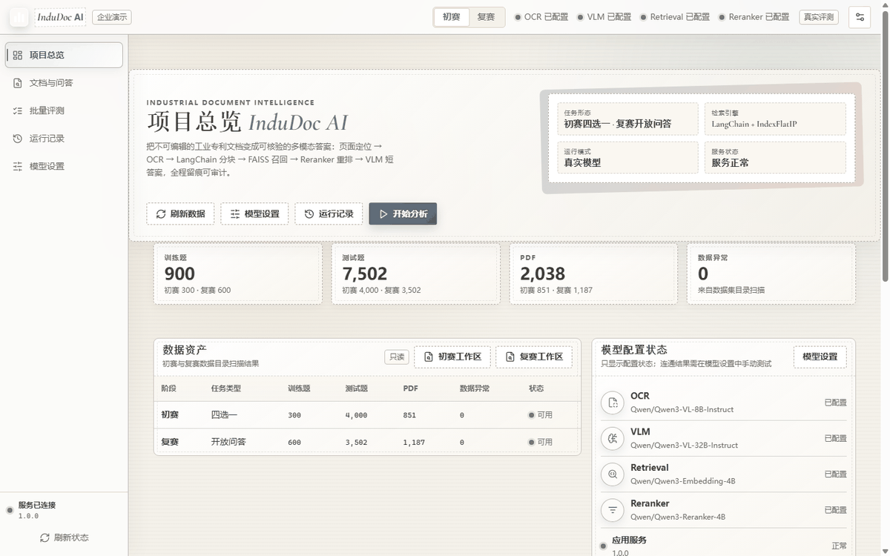
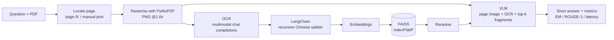
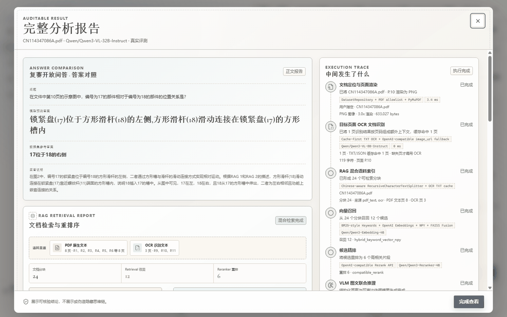
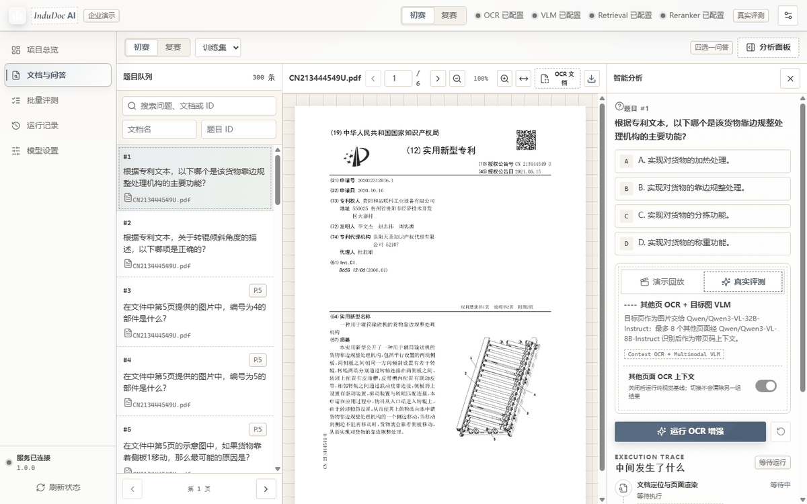
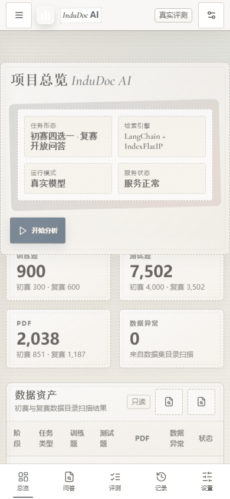

<p align="center">
  <a href="./README.md">简体中文</a> · English
</p>

<!-- README_SYNC: source=working-tree; updated=2026-10-26 -->

<h1 align="center">InduDoc AI · Multimodal QA Evaluation Workbench for Industrial Documents</h1>

<p align="center">
Turns uneditable industrial patent PDFs into a QA pipeline where <strong>every answer carries its evidence page, every run replays its steps, and every score follows the competition's own metric definitions</strong>.
</p>

<p align="center">
If this is the evaluation harness you were about to build, a <a href="https://github.com/2539996722/Multimodal-Reasoning-Question-Answering/stargazers">Star</a> keeps it handy for you and helps others working on the same task find it.
</p>

<p align="center">
  <a href="https://github.com/2539996722/Multimodal-Reasoning-Question-Answering/stargazers"></a>
  <a href="https://github.com/2539996722/Multimodal-Reasoning-Question-Answering/issues"></a>
  <a href="https://github.com/2539996722/Multimodal-Reasoning-Question-Answering/commits/main"></a>
  
  
  
</p>

<p align="center"></p>

> This is the real first-load screen. The 900 / 7,502 / 2,038 figures come from a live scan served by `/api/datasets`; the four model statuses come from runtime configuration. Nothing on that page is hard-coded.

**In one line**: a workbench for the CCKS2025 *Industrial Technical Document Multimodal Reasoning QA* evaluation — covering both the preliminary multiple-choice set (300 + 4,000 questions) and the semi-final open-ended set (600 + 3,502 questions), with an OpenAI-compatible contract on the model side.

**What this is not** (so you can decide quickly):

- **No data included.** Competition PDFs and JSONL must be placed in fixed directories — see [Quick start](#quick-start).
- **No model training.** The app only runs inference and evaluation; the LoRA → vLLM → workbench path lives in [runtime/lora-data/README.md](./runtime/lora-data/README.md).
- **No upload, no multi-tenancy, no distributed scheduling.** A single-operator, single-machine workbench over read-only data.

<details>
<summary>Contents</summary>

- [The problem](#the-problem)
- [Quick start](#quick-start)
- [Pipeline](#pipeline)
- [What a real run leaves behind](#what-a-real-run-leaves-behind)
- [Interface](#interface)
- [Scoring contract](#scoring-contract)
- [A/B result: OCR+VLM baseline vs RAG](#ab-result-ocrvlm-baseline-vs-rag)
- [Four model endpoints](#four-model-endpoints)
- [Dataset scale](#dataset-scale)
- [API at a glance](#api-at-a-glance)
- [Reliability design](#reliability-design)
- [Known limitations](#known-limitations)
- [Tests and acceptance](#tests-and-acceptance)
- [Layout](#layout)
- [License](#license)

</details>

## The problem

Industrial patent documents are **scans**: no text layer, drawings mixed with prose, and answers that often live in a spatial relation inside a numbered figure on page 7. Feed the whole PDF to a general-purpose model and you get a fluent explanation you cannot check — and no idea which page it actually looked at.

So this is not another "chat with your PDF". It treats the **evidence chain** as the product:

| Manual workflow | This workbench |
| --- | --- |
| Scroll to page N and eyeball the drawing | Page number parsed from the question → rendered with PyMuPDF → pinned into the report |
| Paste OCR text into a chat, lose track of context | Chunk → vector recall → rerank, with source pages kept next to every fragment |
| Judge answers by feel | Accuracy / EM / jieba ROUGE-1 under the competition's definitions; missing BERTScore stays `null` |
| Copy-paste 4,000 test items by hand | Batch jobs + progress + retry + competition-format JSONL export |

Three things that separate it from an API wrapper:

1. **Four capabilities, four endpoints.** OCR, VLM, embeddings and reranker are configured independently and can point at different services (local vLLM included).
2. **No inflated metrics.** The official composite needs a real BERTScore; online it is always `null` with an explicit reason, and only the offline regression produces it in an isolated subprocess — an LLM judge score is never passed off as the official one.
3. **Visible degradation.** When RAG is unavailable the run is labelled "degraded to target-page OCR + VLM" instead of pretending retrieval happened.

## Quick start

Python 3.10+ is required; `node` is only needed for the browser acceptance run.

```powershell
git clone https://github.com/2539996722/Multimodal-Reasoning-Question-Answering.git
cd Multimodal-Reasoning-Question-Answering

py -3 -m venv .venv
.\.venv\Scripts\Activate.ps1
python -m pip install -r requirements.txt
```

**1) Drop the competition data into the expected directories** (not shipped with the repo; these paths are hard-coded in [`app/services/dataset.py`](./app/services/dataset.py)):

```text
preliminary_dataset/
  train/questions.jsonl            # 300 questions (include the answer field)
  test/questions.jsonl             # 4,000 questions
  test/answers.jsonl               # 4,000 reference answers
  {train,test}/documents/*.pdf     # 851 PDFs
semi_final_dataset/
  train/train.jsonl                # 600 questions (include the answer field)
  test/test.jsonl                  # 3,502 questions
  test/answers.jsonl               # 3,502 reference answers
  {train,test}/documents/*.pdf     # 1,187 PDFs
```

**2) Point the four endpoints somewhere.** Environment variables or the in-app "Model settings" page both work; the VLM endpoint can also be a vLLM server you host yourself:

```powershell
$env:OCR_BASE_URL       = "https://api.siliconflow.cn/v1"
$env:OCR_API_KEY        = "<your-key>"
$env:OCR_MODEL          = "Qwen/Qwen3-VL-8B-Instruct"

$env:VLM_BASE_URL       = "https://api.siliconflow.cn/v1"
$env:VLM_API_KEY        = "<your-key>"
$env:VLM_MODEL          = "Qwen/Qwen3-VL-32B-Instruct"

$env:RETRIEVAL_BASE_URL = "https://api.siliconflow.cn/v1"
$env:RETRIEVAL_API_KEY  = "<your-key>"
$env:RETRIEVAL_MODEL    = "Qwen/Qwen3-Embedding-4B"

$env:RERANKER_BASE_URL  = "https://api.siliconflow.cn/v1"
$env:RERANKER_API_KEY   = "<your-key>"
$env:RERANKER_MODEL     = "Qwen/Qwen3-Reranker-4B"
```

**3) Start it** (`start` runs in the background and writes `runtime/server.pid` plus `runtime/server.log`; `status` prints port and PID):

```powershell
.\start.bat
.\start.bat start
.\start.bat status
```

**4) Open <http://127.0.0.1:8000>**, run the connectivity test on the settings page, then analyse any question.

> It starts without any model configured too: the UI enters a **clearly labelled** demo mode that replays reference answers, and never presents a replay as model output. Batch evaluation always uses the real pipeline and fails with a configuration error when endpoints are incomplete — it does not silently degrade.

## Pipeline



Semi-final questions default to `use_rag=true`. Without retrieval/reranker endpoints, or with RAG turned off, the run degrades to target-page OCR + VLM and says so in both the trace and the run summary.

## What a real run leaves behind

<p align="center"></p>

On the left, the predicted answer next to the reference. In the middle, the retrieval report (24 chunks → 12 recalled → 6 reranked, with corpus sources labelled as native PDF text or OCR text). On the right, a six-step trace: locate and render → OCR the target page → chunk → vector recall → rerank → joint image-text reasoning, each with latency and provider tags.

The point of this screenshot is simple: **when an answer is wrong, you can see which step went wrong** — not just a sentence of model output.

## Interface

<table>
<tr>
<td></td>
<td></td>
</tr>
<tr>
<td>Question queue, PDF preview and evidence panel stay in sync; entries marked "P.5" jump straight to the evidence page.</td>
<td>The same UI at 390px wide, with no horizontal page scrolling.</td>
</tr>
</table>

The front end is plain HTML/CSS/JS — no framework, no build step, self-hosted fonts, and no runtime CDN dependency.

## Scoring contract

| Field | Meaning | Online |
| --- | --- | :---: |
| `accuracy` | Multiple-choice accuracy (preliminary) | ✅ |
| `exact_match` | Normalised EM (semi-final) | ✅ |
| `rouge1_f1` | jieba-tokenised ROUGE-1 F1 (competition definition) | ✅ |
| `semantic_f1` | **LLM judge score** from any OpenAI-compatible model — not the official BERTScore | opt-in |
| `semantic_proxy_score` | Weighted proxy using the official weights; the name says `proxy` | opt-in |
| `bert_f1` | Real BERTScore only; always `null` online, with `bert_f1_reason` | ❌ |
| `final_score` | `0.5×BERTScore + 0.25×ROUGE-1 + 0.25×EM`, produced by the offline regression only | ❌ |

The semantic judge is an extra model call and is off by default; pass `evaluate_semantic: true` per request or per batch.

**Why `null` is not a bug**: `bert_score` loads `torch`, and `torch` plus `faiss` in one process hard-crashes (the process exits with no traceback). BERTScore therefore runs only inside [`scripts/bertscore_worker.py`](./scripts/bertscore_worker.py); if that subprocess is unavailable or times out, the field is reported as "not computed" with a reason instead of a made-up number.

## A/B result: OCR+VLM baseline vs RAG

Semi-final train split, seed `20261025`, 8 questions across 4 PDFs (grouped by PDF, identical question set for both arms):

| Metric | baseline (target-page OCR + VLM) | rag (chunk → FAISS → rerank → VLM) | Δ |
| --- | ---: | ---: | ---: |
| EM | 0.1250 | 0.2500 | **+0.1250** |
| ROUGE-1 F1 | 0.6005 | 0.6327 | +0.0322 |
| BERTScore F1 (bert-base-chinese) | 0.7987 | 0.8244 | +0.0256 |
| Official composite | 0.5808 | **0.6329** | **+0.0521** |
| Recall@1 / @3 / @6 | n/a | 0.40 / 0.40 / 0.60 | — |
| MRR | n/a | 0.45 | — |
| Mean latency | 69.3 s | 60.7 s | −8.6 s |
| P95 latency | 127.8 s | 103.4 s | −24.4 s |

Raw reports live in [`runtime/regression/`](./runtime/regression) and reproduce with:

```powershell
python scripts\evaluate_regression.py --size 8 --seed 20261025 --arms baseline,rag --timeout 300
```

> **Eight questions across four PDFs is not statistically meaningful.** Treat it as a smoke test of the harness; publishable claims need a run at `--size 60` or more. Retrieval metrics only cover the 5 questions whose text names a page; the other 3 are reported as "not applicable" rather than 0.

## Four model endpoints

Each capability carries its own Base URL / API key / model / timeout and is persisted to `runtime/model-settings.json` (plaintext keys, gitignored). Public responses expose only `api_key_set` and `configured` — keys are never echoed.

A configuration that has been exercised end to end (SiliconFlow):

| Role | Model | Observed |
| --- | --- | --- |
| OCR | `Qwen/Qwen3-VL-8B-Instruct` | ~20 s per page; reliably reads part numbers off Chinese patent pages |
| VLM (quality) | `Qwen/Qwen3-VL-32B-Instruct` | 37–70 s per question; clearly better than 8B on spatial relations |
| VLM (speed) | `Qwen/Qwen3-VL-8B-Instruct` | 20–30 s per question |
| Retrieval | `Qwen/Qwen3-Embedding-4B` | native `POST /v1/embeddings` |
| Reranker | `Qwen/Qwen3-Reranker-4B` | native `POST /v1/rerank`, falls back to chat scoring |

Three things we hit the hard way:

- **The OCR prompt decides the output shape.** With a generic "describe this page" prompt, PaddleOCR-VL runs to `max_tokens` (155 s, 2,400 tokens). Test any new model with the real prompt on one page first.
- **Do not send `image_url.detail`.** Several gateways reject it with a 400 (`Input should be a valid string`); it is omitted unless `MODEL_IMAGE_DETAIL=high` is set.
- **Upstream tail latency is real.** Sustained traffic can push one page from 20 s to 160 s, so OCR has its own timeout and a precomputed corpus keeps repeat OCR off the network.

Pointing at a vLLM server you host: `configured` requires all three of base URL, API key and model, while vLLM has no auth by default — start it with `--api-key`, or put any non-empty string in the settings page; the model name is the alias on the left of `--lora-modules`, not the weight path. Mind the port: the workbench itself binds 8000, so a same-host vLLM needs another port (`8001`, say); across machines use `http://<instance-ip>:8000/v1`.

## Dataset scale

| Stage | Task | Train | Test | PDFs | Metric |
| --- | --- | ---: | ---: | ---: | --- |
| Preliminary | 4-way multiple choice | 300 | 4,000 | 851 | Accuracy |
| Semi-final | Open-ended QA | 600 | 3,502 | 1,187 | 0.5×BERTScore + 0.25×ROUGE-1 + 0.25×EM |

Source JSONL and PDFs are strictly read-only; there is no upload path.

## API at a glance

| Method | Path | Purpose |
| --- | --- | --- |
| GET | `/api/health`, `/api/health/live`, `/api/health/ready` | Service, dataset and RAG readiness |
| GET | `/api/datasets` | Asset and anomaly counts (source of the dashboard numbers) |
| GET | `/api/questions` | Paginated question browser |
| GET | `/api/questions/{stage}/{split}/{id}` | Question detail with reference answer |
| GET | `/api/documents/{stage}/{split}/{filename}` | Original PDF (inline or download) |
| GET | `/api/documents/{stage}/{split}/{filename}/pages/{page}` | Single page as PNG |
| GET | `/api/documents/{stage}/{split}/{filename}/ocr` | Read-only view of the precomputed OCR corpus |
| POST | `/api/analyze`, `/api/analyze/stream` | Single-question analysis (SSE stage events) |
| POST/GET | `/api/jobs`, `/api/jobs/{id}` | Create a batch job, list jobs, poll progress |
| POST | `/api/jobs/{id}/cancel`, `/api/jobs/{id}/retry` | Cancel, retry failed items |
| GET | `/api/jobs/{id}/export` | Competition-format JSONL (`{"id":...,"answer":...}` per line) |
| GET | `/api/runs` | Last 100 run summaries |
| GET/PUT | `/api/settings/models` | Read (redacted) or update the four endpoints |
| POST | `/api/settings/models/test` | Explicit connectivity test |

Errors share one envelope (message strings are Chinese in the current build):

```json
{"error": {"code": "DOCUMENT_NOT_FOUND", "message": "未找到指定文档", "request_id": "...", "retryable": false}}
```

## Reliability design

- **Index lifecycle**: `absent → building → ready → stale / failed`. The version key covers PDF fingerprints, chunking parameters, embedding model, vector dimension and schema — any change marks the old version stale, and cross-model or cross-dimension reuse is refused.
- **Single-flight builds**: per-document locks plus a bounded global semaphore; results are verified in a temp directory and published atomically, and a failed build keeps the previous ready version.
- **Query snapshots**: a retrieval binds one immutable ready version from start to finish, so publishing a new index never affects in-flight requests.
- **Three safe files per index**: `vectors.npy` (`allow_pickle=False`), `documents.json`, `manifest.json`, reloaded into `IndexFlatIP`; no pickle, no joblib, no dangerous deserialisation.
- **OCR corpus identity**: a mismatched PDF fingerprint or a different OCR model marks the corpus stale — it stops being evidence, live OCR takes over, and the UI shows which model produced the old text.
- **Degradation ladder**: last ready index → rebuild → lexical recall → skip reranker → target-page OCR + VLM → explicit demo/failure. Every step is visible in the UI and the run summary.
- **No sensitive logging**: endpoint host, model name, status code, latency and a redacted error summary only; never keys, PDF or OCR text, full prompts/responses, or hidden reasoning.

## Known limitations

| Symptom | Cause and fix |
| --- | --- |
| `MODEL_BALANCE_EXHAUSTED` | Upstream 402 (out of credit); not retryable — switch endpoint or top up |
| `MODEL_REQUEST_REJECTED` with an upstream 400 | The gateway rejected request fields; `image_url.detail` is already removed by default |
| `MODEL_TIMEOUT` | Slow upstream; raise `OCR_TIMEOUT_SECONDS` / `VLM_TIMEOUT_SECONDS` |
| Semi-final OCR says the corpus is stale | OCR model or source PDF changed; rebuild with `scripts/precompute_semifinal_ocr.py` |
| `pytest` exits 3 with no traceback | `torch` and `faiss` were mixed in one process; BERTScore must stay in a subprocess |
| Page number out of range | The PDF still previews; the page-PNG endpoint returns an explicit capability error |

## Tests and acceptance

```powershell
python -m pytest -q
node --check runtime\browser-check.mjs
node .\runtime\browser-check.mjs
```

The first command runs 12 test modules covering the API contract, retrieval, jobs and metrics. The last two need a running server; they perform the three-viewport acceptance run and write screenshots plus `report.json`.

`runtime/browser-check.mjs` drives headless Chrome over CDP at 1440×900 / 1024×768 / 390×844 and checks live dashboard stats, model status, PDF preview, the full analysis report, RAG hits, the four password fields in settings, the loading/empty/error states, page-level horizontal overflow and console errors/warnings. It writes `runtime/browser-artifacts/*.png` plus `report.json` and exits non-zero on any failure.

## Layout

```text
app/
  main.py            FastAPI entry, request context, error envelope, security headers
  config.py          Four-endpoint config, env overrides, persistence
  api/routes.py      All /api routes
  services/
    dataset.py       Read-only JSONL/PDF index and statistics
    documents.py     PDF metadata and page rendering
    analysis.py      Single-question pipeline (locate → OCR → RAG → VLM → metrics)
    retrieval.py     LangChain chunking, FAISS index lifecycle, retrieval and reranking
    openai_client.py OpenAI-compatible client
    jobs.py          In-process batch job manager
    evaluation.py    EM / jieba ROUGE-1 / official weighted score
  static/            Plain front end (no framework, no runtime CDN)
scripts/
  evaluate_regression.py           Regression evaluation and A/B comparison
  bertscore_worker.py              BERTScore in an isolated subprocess
  precompute_semifinal_ocr.py      Precompute the semi-final OCR corpus
  build_lora_dataset.py            Semi-final figures → ShareGPT training set
tests/               pytest unit and contract tests
docs/images/         README screenshots
runtime/             Runtime artefacts (settings, corpus, indexes, reports, exports)
start.bat            Windows launcher (run/start/stop/status/restart)
```

## License

There is **no `LICENSE` file in this repository today**. Until one is added, all rights are reserved: you may read the code and run it locally, but that is not a grant to copy, modify or redistribute it.

If you plan to keep it open, add a standard licence that matches your intent (MIT / Apache-2.0 if commercial use is fine, or something like PolyForm Noncommercial if it is not) and update this section together with the repository's About panel. Third-party dependencies (FastAPI, LangChain, FAISS, PyMuPDF, jieba) and the competition data keep their own terms; a project licence cannot cover rights the project does not own.

---

<p align="center">
If this saved you some setup time, a <a href="https://github.com/2539996722/Multimodal-Reasoning-Question-Answering/stargazers">Star</a> is a useful bookmark for you;
questions and feature requests are welcome in <a href="https://github.com/2539996722/Multimodal-Reasoning-Question-Answering/issues">Issues</a>.
</p>
